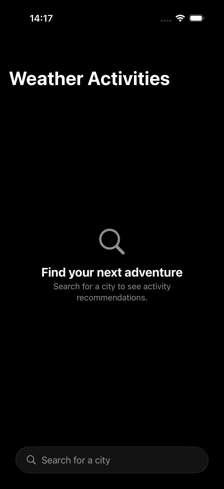
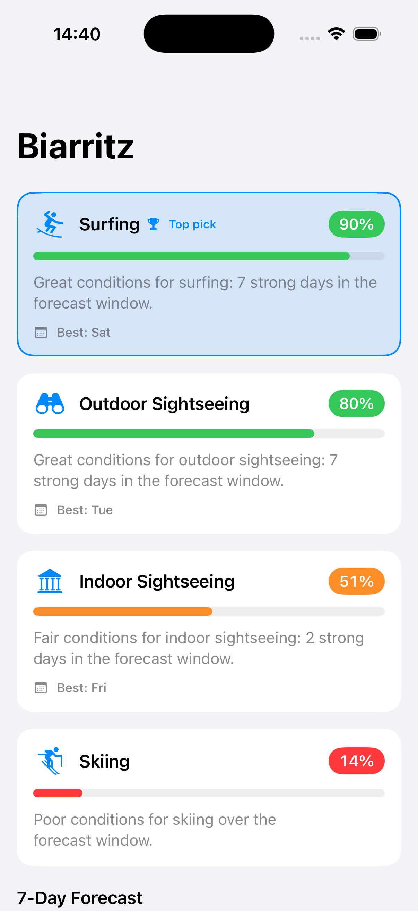
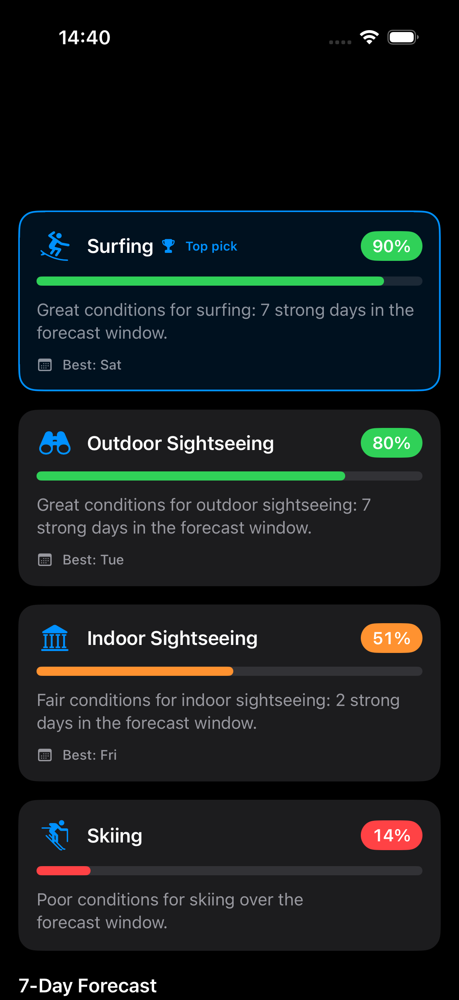

# WeatherActivities

A native iOS app that lets you search for a city and see a **ranked list of activities**
(Skiing, Surfing, Outdoor sightseeing, Indoor sightseeing) suited to that location's
**next 7 days** of weather, using the free [Open-Meteo](https://open-meteo.com) APIs. No backend.

| Search | Ranking (light) | Ranking (dark) |
|---|---|---|
|  |  |  |

---

## 1. Project overview *(deliverable a)*

The user types a city name → the app debounces and queries Open-Meteo's **Geocoding**
API → on selecting a city it fetches a 7-day **Forecast** → a pure scoring engine ranks
the four activities by how well the weather suits each one, with a per-activity score,
a short rationale, and the best day in the window.

The interesting engineering is not the screens; it is (1) turning weather into an
**explainable, testable suitability model**, and (2) keeping clean seams between UI,
domain, data, and state so each piece can be verified on its own.

---

## 2. Platform & tooling choices *(deliverable b)*

| Choice | What & why |
|---|---|
| **Language** | Swift 6 (language mode 6, `SWIFT_STRICT_CONCURRENCY = complete`). Concurrency-safety is enforced by the compiler. |
| **UI** | SwiftUI, `@Observable` view models (Observation framework, iOS 17+). |
| **Async** | `async/await` + structured concurrency (`Task`, cancellation) throughout. No Combine, no callbacks. |
| **Min iOS** | 17.0 (enables `@Observable`). Built against the iOS 26 SDK / Xcode 26. |
| **Project generation** | [XcodeGen](https://github.com/yonyz/XcodeGen) — `project.yml` is the source of truth; the `.xcodeproj` is generated. (The generated project is also committed so it opens with no extra tooling.) |
| **Dependencies** | **None.** Foundation + SwiftUI + XCTest only. Nothing to resolve, nothing to break. |
| **Tests** | XCTest (95 tests). |

---

## 3. Build & run *(deliverable d)*

**Requirements:** macOS with Xcode 16+ (developed on Xcode 26) and an iOS 17+ simulator.

**Option A — open and run (no tooling needed):**
```bash
open WeatherActivities.xcodeproj
# Select the "WeatherActivities" scheme + an iPhone simulator, then ⌘R.
```

**Option B — regenerate the project first** (if you have [XcodeGen](https://github.com/yonyz/XcodeGen), `brew install xcodegen`):
```bash
xcodegen generate          # regenerates WeatherActivities.xcodeproj from project.yml
open WeatherActivities.xcodeproj
```

**Command line:**
```bash
xcodebuild -project WeatherActivities.xcodeproj -scheme WeatherActivities \
  -destination 'platform=iOS Simulator,name=iPhone 17 Pro' build
```

The app is configured to run on the **simulator with no signing team** (signing is disabled
in `project.yml`); flip signing on to run on a device.

---

## 4. Tests & testing strategy *(deliverable e)*

```bash
xcodebuild -project WeatherActivities.xcodeproj -scheme WeatherActivities \
  -destination 'platform=iOS Simulator,name=iPhone 17 Pro' test
```
**95 unit tests, all passing.** The suite concentrates on "the most important logic and
state handling," as the brief asks:

- **Scoring** (`Tests/Scoring`) — the core. Scenario tables drive each activity (snowy/cold
  → skiing; windy/mild → surfing; warm/dry/sunny → outdoor; rainy/stormy or fog → indoor),
  plus score-bounds (`0...1`), deterministic ranking & tie-break, `bestDayIndex`, empty
  forecast, the curve helpers, and `ScoreTier` boundaries.
- **Mapping** (`Tests/Mapping`) — the columnar→rows zip, length-mismatch failure, null
  coalescing, missing-optional-field decoding, and **timezone-correct date parsing**
  (a western-hemisphere city keeps its calendar day).
- **Network** (`Tests/Network`) — URL/query construction; `URLSessionHTTPClient` against a
  `URLProtocol` stub (success / 500 / offline / timeout / **cancelled** / malformed JSON).
- **Repositories** (`Tests/Repositories`) — cache write-through on success; offline/timeout
  fallback to cache (asserting the network *was* attempted and the cache *was* read);
  server errors propagate **without** touching the cache.
- **View models** (`Tests/ViewModels`) — the full search state machine, debounce,
  task cancellation, retry, and the ranking VM's load/empty/error/staleness behavior.

**Design for testability:** every cross-layer dependency is a protocol, so tests inject
fakes (`Tests/Mocks`) — no live network. Fixtures (`Tests/Fixtures`) are real Open-Meteo
payloads (including the no-results and null-sample shapes) so decoding is exercised against
the true contract. Time is injected (`now: () -> Date`) and the search debounce is
injectable (`.zero` in tests) so nothing is flaky.

---

## 5. Architecture & technical decisions *(deliverable c)*

MVVM with a light Clean-Architecture layering. The dependency arrows always point inward:
**Presentation → Domain ← Data**. The `Domain` layer imports nothing from `Data` or SwiftUI.

```
Sources/
  App/            WeatherActivitiesApp (@main), AppContainer (composition root / DI)
  Domain/
    Models/       City, DailyWeather, WeatherForecast, Activity, ActivityScore,
                  ActivityRanking, ScoreTier, AppError
    Scoring/      ActivityScoring (protocol), WeatherActivityScorer, ScoringCurves
  Data/
    Network/      HTTPClient (protocol), URLSessionHTTPClient, Endpoints
    DTO/          GeocodingResponseDTO, ForecastResponseDTO        (wire shapes)
    Mapping/      CityMapper, ForecastMapper                       (DTO → domain)
    Repositories/ GeocodingRepository, ForecastRepository (+ Live impls)
    Cache/        ForecastCache (protocol), DiskForecastCache, InMemoryForecastCache
  Presentation/
    Common/       ViewState<T>, StateView, WeatherCode, Activity+Display, WeekdayFormatter
    CitySearch/   CitySearchViewModel (@Observable @MainActor), CitySearchView
    Activities/   ActivityRankingViewModel (@Observable @MainActor), ActivityRankingView
    Components/   ActivityCard, ScoreBadge, DailyStrip
```

Key decisions:

- **Protocol-based DI.** `HTTPClient`, `GeocodingRepository`, `ForecastRepository`,
  `ForecastCache`, `ActivityScoring` are all protocols. `AppContainer` is the single
  composition root that wires the live graph; view models receive protocols, so production
  and tests differ only in what is injected.
- **Explicit state modeling.** A single generic `ViewState<T>` enum
  (`idle / loading / loaded / empty / failed(AppError)`) drives both screens. Impossible
  states (loading *and* error) are unrepresentable, the view is a pure function of state,
  and because it is `Equatable`, transitions are directly assertable in tests.
- **DTO ≠ domain.** Open-Meteo's forecast is *columnar* (`daily.time[]`,
  `daily.temperature_2m_max[]`, …). That wire quirk lives only in the DTO; `ForecastMapper`
  zips the columns into row-shaped `DailyWeather`, so no view ever sees a parallel array.
- **Pure domain.** `WeatherActivityScorer` is a stateless `struct` of pure functions →
  trivially `Sendable` and exhaustively unit-testable.
- **Concurrency.** View models are `@MainActor`; caches are `actor`s; repositories and
  models are `Sendable` value types. The search uses structured concurrency: each keystroke
  starts a `Task` that debounces then queries, and cancels the previous one, so a stale
  response can never overwrite a newer query.
- **Robust errors.** Transport/decoding failures are mapped to a domain `AppError`
  (`offline / timeout / server / decoding / notFound / unknown`) and surfaced via
  `ViewState.failed` with a friendly message and a Retry button — the UI never sees
  `URLError`/`DecodingError`.

---

## 6. Activity recommendation logic *(deliverable g)*

Each activity gets a **per-day** suitability score in `0...1`, built from a few reusable,
normalized curves (`ScoringCurves`): `ramp` (ascending), `inverseRamp` (descending),
`band` (a comfortable plateau with linear falloff), and `clamp`. The activity's overall
score is the **mean across the 7 days**; we also keep each activity's **best single day**.

Let `tMax, appMax = apparent max, precip (mm), snow (cm), pop (% precip-probability),
wind, gust (km/h), sun (seconds)`. WMO codes: storm `95–99`, fog `45/48`.

| Activity | Per-day score (clamped to `0…1`) | Intuition |
|---|---|---|
| **Skiing** | `0.55·ramp(snow,0→5) + 0.30·inverseRamp(tMax,0→6) + 0.15·inverseRamp(gust,40→70)` | Needs fresh snow, sub-zero temps, manageable wind. A warm, snowless day scores ~0 — no "ski in July". |
| **Surfing** | `(0.60·band(wind,18–35,±12) + 0.40·ramp(appMax,8→18)) · stormPenalty` | Wind in a sweet-spot band as a wave proxy (too little = flat, too much = blown out), mild warmth; storms cut the score to 30% for safety. |
| **Outdoor** | `(0.30·band(appMax,16–24,±8) + 0.25·inverseRamp(precip,1→8) + 0.15·inverseRamp(pop,20→70) + 0.15·inverseRamp(wind,20→45) + 0.15·ramp(sun,3h→8h)) · severePenalty` | Comfortable, dry, calm, sunny. Fog/storms apply a 0.6 penalty. |
| **Indoor** | `clamp(0.35 + 0.65·(1 − outdoorScore) + unpleasantBonus)` | A **fallback that inversely tracks Outdoor**: rises when it's foul outside, sinks when it's glorious. `+0.10` when actively unpleasant (storm/fog, feels-like < 2 °C or > 32 °C, or > 10 mm rain). |

The four activities are then ranked best-first. Ties break deterministically by a fixed
activity order, so the same forecast always yields the same ranking.

Modelling **Indoor as `1 − Outdoor` (plus a floor)** is deliberate: the four activities
behave as one coherent system rather than four unrelated formulas.

The weights and thresholds are transparent **heuristics**, chosen to be sensible and
explainable, not statistically calibrated — see Assumptions and Trade-offs.

---

## 7. API usage notes *(deliverable f)*

Two Open-Meteo endpoints, no key required:

- **Geocoding** — `GET https://geocoding-api.open-meteo.com/v1/search`
  with `name`, `count=10`, `language=en`, `format=json`. When there are no matches the
  service omits the `results` key entirely (mapped to `[]`), and it omits empty fields per
  result (so every descriptive `City` field except id/name/lat/lon is optional).
- **Forecast** — `GET https://api.open-meteo.com/v1/forecast`
  with `latitude`, `longitude`, `timezone=auto`, `forecast_days=7`, and `daily=` these
  **10** variables: `weather_code, temperature_2m_max, temperature_2m_min,
  apparent_temperature_max, precipitation_sum, snowfall_sum, precipitation_probability_max,
  wind_speed_10m_max, wind_gusts_10m_max, sunshine_duration`. Units are the metric defaults
  (°C, mm, cm, km/h, seconds).

`daily` arrays are parallel and keyed by `daily.time` (local `yyyy-MM-dd` dates, because
`timezone=auto`). The mapper zips them by index, coalesces any `null` sample to `0`, and
fails fast (`AppError.decoding`) on a length mismatch or unparseable date.

---

## 8. Assumptions made *(deliverable h)*

- **Surfing has no wave data.** The Forecast API exposes no swell/period; surfing is a
  documented **wind + warmth proxy**. (Open-Meteo's separate Marine API would be the real
  fix — see Production-readiness.)
- **Weather fields used:** the 10 daily variables above. Skiing leans on snowfall + max
  temp + gusts; surfing on wind + feels-like; outdoor on feels-like, precipitation,
  precip-probability, wind, sunshine; indoor is derived from outdoor.
- **Aggregation:** simple mean across the 7 days; each day weighted equally.
- **Scoring weights/thresholds** are hand-tuned heuristics, not calibrated against data.
- **Dates:** `daily.time` is parsed in the **city's** timezone so the daily strip shows the
  city's local calendar days (a forecast for Los Angeles shows LA's days, not the device's).
- **Search:** 300 ms debounce; a query must be ≥ 2 characters (the Geocoding API's minimum).
- **Tie-break:** equal scores rank by a fixed activity order for determinism.
- **Offline staleness:** a loaded forecast older than 30 minutes is shown with a "saved
  forecast" banner (this is how cache-served-while-offline data is surfaced).

---

## 9. Trade-offs & omissions *(deliverable i)*

- **No Marine API** → surfing is a proxy (above). Conscious scope choice: one data source,
  matching the brief's "Forecast API for weather data".
- **No UI / snapshot tests.** The brief de-prioritizes them and they add a dependency
  (`swift-snapshot-testing`) or flakiness; effort went into unit tests + a live integration
  smoke + manual simulator verification instead. The architecture is snapshot-ready.
- **Heuristic scoring**, not calibrated — a deliberate scope choice; the curves are isolated
  and trivial to retune.
- **Length-mismatch is a hard failure.** If Open-Meteo ever returned a daily column shorter
  than `time`, the whole forecast is rejected rather than partially shown. The documented
  null-padding case is handled; a genuinely ragged payload is treated as malformed.
- **`cannotConnectToHost` is classified as "offline."** A server-side outage reads to the
  user as a connectivity problem (and triggers the cache fallback). Acceptable simplification.
- **Single locale / no i18n.** UI strings are English; only the date/number formatting is
  locale-aware.
- **No persistence of the last city / search history**, no map or geolocation, single
  device family (iPhone, portrait).

---

## 10. Production-readiness notes *(deliverable j)*

What I'd add before shipping this for real:

- **Networking:** retry with backoff, request timeouts, rate-limit handling, ETag/`If-Modified-Since`
  caching, and Open-Meteo's commercial API key for higher quotas.
- **Surfing:** integrate the **Marine API** (wave height/period/direction) for a real model.
- **Resilience:** make the forecast mapper tolerant of ragged columns (pad to `time.count`)
  and distinguish "no data" from a zeroed sample.
- **Observability:** structured logging, crash reporting, and analytics on search/selection.
- **Quality gates:** CI running `xcodebuild test` on PRs, SwiftLint/SwiftFormat, and snapshot
  tests for the cards.
- **UX/Accessibility:** a full VoiceOver/Dynamic Type audit, localization, an explicit
  "best day" detail, and possibly hourly granularity.
- **Caching:** evict/expire disk cache entries and bound its size.

---

## 11. Cross-platform delivery notes *(deliverable k)*

The design maps cleanly onto Android and is friendly to a shared core:

- **The domain layer is platform-agnostic.** `WeatherActivityScorer`, `ScoringCurves`,
  `ScoreTier`, and the model/value types are pure Swift with no UIKit/SwiftUI/Foundation-
  networking ties — the exact logic that should be **shared via Kotlin Multiplatform (KMP)**
  so iOS and Android rank activities identically from one source of truth.
- **Repository/use-case parity.** `GeocodingRepository` / `ForecastRepository` /
  `ForecastCache` map 1:1 onto Kotlin interfaces backed by Ktor + kotlinx.serialization;
  the same Open-Meteo contract and DTO→domain mapping apply.
- **Presentation mirrors.** `@Observable` view models + `ViewState<T>` correspond directly to
  a Jetpack Compose `ViewModel` exposing a `StateFlow<ViewState>`; the SwiftUI screens map to
  Compose composables with the same state-driven rendering.
- **Shared contracts.** The API request/response shapes and the scoring spec in §6 are the
  canonical cross-platform reference, so both apps stay behaviorally identical.

---

## 12. AI usage disclosure & verification *(deliverable l)*

**AI usage:** this project was built with **Claude Code** (Anthropic) acting as a pair
programmer — scaffolding, drafting layer implementations and tests, and a multi-pass code
review. Every line was reviewed and, more importantly, **verified**; the brief's standard is
"AI usage is allowed, poor verification is not," so verification was treated as the deliverable:

- **95 unit tests** pass (`xcodebuild test`), concentrated on the scoring, mapping, network,
  repository, and view-model logic.
- **Live integration smoke** against the real Open-Meteo API confirmed end-to-end decoding +
  scoring and that rankings are **season-aware** (run mid-June): Biarritz → Surfing 90%;
  Singapore / Dubai (hot/humid/extreme) → Indoor; Chamonix (alpine summer) correctly does
  **not** rank skiing; Ushuaia (Southern-Hemisphere winter) elevates the cold-weather
  activities. (This throwaway check is not committed, to keep the suite network-free.)
- **Runtime verification on the simulator** (iPhone 17 Pro) — the screenshots above are from
  the running app; pull-to-refresh, dark mode, and the empty/idle/error states were exercised.
- **Adversarial code review** across correctness, concurrency, presentation, and test-quality
  angles; confirmed findings (a search-cancellation false error, a daily-strip timezone
  off-by-one, score-tier inconsistency) were fixed and pinned with new regression tests.
